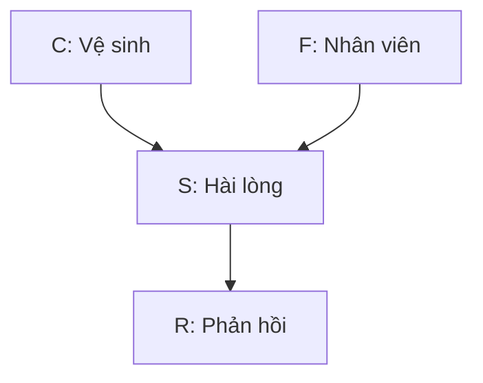

# Bayesian Network — Mạng Bayes cho mô hình hóa xác suất

> **Nhánh trong bảng:** MACHINE LEARNING → Supervised: Probabilistic. **Nguồn:** dòng 20. **Đối chiếu:** 28/10/2026. Bayesian Network rộng hơn một bộ phân loại có giám sát; bài minh họa truy vấn một biến mục tiêu trong mạng rời rạc. Đồ thị, xác suất và tình huống khách sạn đều tự đặt, không phải quan hệ nhân quả đã được chứng minh.

| Trường | Nội dung |
|---|---|
| Bản chất | Mô hình đồ thị có hướng không chu trình biểu diễn phân rã phân bố xác suất |
| Mốc tham khảo | Tutorial của Heckerman có bản gốc được ghi xuất bản năm 1999, bản arXiv cập nhật đến 2022 [S1]; không coi ngày tải arXiv là năm BN ra đời |
| Đầu vào | Biến, trạng thái, đồ thị, CPD/thông tin học tham số và bằng chứng quan sát |
| Đầu ra | Posterior truy vấn, dự đoán, độ phù hợp mô hình hoặc cấu trúc học được tùy nhiệm vụ |
| Văn bản/tiếng Việt | Thường cần bước trích biến từ văn bản trước; sai số bước này phải được xem xét |
| Nhãn | Nếu dự đoán biến đích bằng học có giám sát cần quan sát/nhãn đích; BN cũng có thiết kế biến ẩn hoặc CPD chuyên gia |
| Tính toán | Suy luận exact phụ thuộc cấu trúc và kích thước trạng thái, không chỉ số dòng dữ liệu |
| Phần mềm | pgmpy là công cụ tham khảo; mã minh họa dưới dùng thư viện chuẩn để kiểm tra phép suy luận trực tiếp |

## 1. Định nghĩa học thuật

Bayesian Network — BN — gồm một DAG và các phân bố có điều kiện cho mỗi biến theo cha của nó. Cấu trúc cho phép phân rã phân bố chung thành tích các thành phần cục bộ [S1].

Các cạnh biểu diễn cấu trúc xác suất/giả định phụ thuộc, không tự là mũi tên nhân quả. Muốn dùng như causal Bayesian network cần giả định nhân quả và thiết kế nhận diện bổ sung. Không suy rằng vẽ được đồ thị thì đã chứng minh tác động của dịch vụ tới hài lòng.

## 2. Giải thích đơn giản

Thay vì ghi một bảng khổng lồ cho mọi tổ hợp sự kiện, bạn chia thành các bảng nhỏ: mức hài lòng theo vệ sinh và nhân viên; khả năng có phản hồi tích cực theo mức hài lòng.

Khi quan sát một phần, bạn cập nhật phần chưa biết bằng các bảng đã đặt/học. Mạng có thể trả lời cả câu hỏi từ nguyên nhân giả định đến biểu hiện và từ biểu hiện quay lại trạng thái chưa biết, nhưng chiều suy luận không đồng nghĩa chiều can thiệp nhân quả.

## 3. Mục đích và vấn đề giải quyết

Đề xuất nghiên cứu: biểu diễn quan hệ giữa đánh giá vệ sinh, tương tác nhân viên, hài lòng và lời nhận xét, rồi suy posterior khi chỉ quan sát một số biến. Có thể kết hợp biến khảo sát và chỉ báo trích từ văn bản.

Nếu chỉ cần phân loại hàng chục nghìn feature từ, NB/LR có thể là baseline thuận tiện hơn. BN hữu ích khi cấu trúc biến và truy vấn xác suất là phần quan trọng của câu hỏi, không chỉ vì đồ thị nhìn trực quan.

## 4. Điều kiện và giả định sử dụng

Cần định nghĩa biến/trạng thái, DAG hợp lệ, CPD chuẩn hóa và dữ liệu/tri thức phù hợp để gán tham số. Cấu trúc ngụ ý các độc lập có điều kiện cần được xem xét.

Nếu dữ liệu được lấy từ người đã để lại đánh giá, phân bố đó có thể khác toàn bộ khách. Suy luận theo mạng không tự sửa thiên lệch chọn mẫu. Biến trích từ sentiment model cũng có lỗi đo; coi nó là quan sát hoàn hảo là một giả định cần đánh giá.

## 5. Cơ chế hoạt động bên trong

Có ba nhiệm vụ riêng: **học cấu trúc**, **học tham số** và **suy luận**. Có thể xác định DAG bằng chuyên gia rồi học CPD, hoặc học cấu trúc theo dữ liệu/ràng buộc; sau đó truy vấn khi có evidence [S2–S3].

Suy luận exact có thể loại biến bằng cộng/tích factor; enumeration liệt kê toàn bộ tổ hợp là cách nhỏ để hiểu nguyên lý. Với mạng lớn, chi phí phụ thuộc cách biến kết nối và thuật toán; không mặc định mọi BN đều chạy nhanh vì có bảng cục bộ.

## 6. Quy trình áp dụng trong nghiên cứu

1. Xác định biến, trạng thái và truy vấn chính.
2. Chỉ rõ nguồn từng biến: khảo sát, hồ sơ, văn bản hay biến ẩn.
3. Đề xuất DAG với lý do; phân biệt giả định dự đoán và nhân quả.
4. Chia dữ liệu trước học cấu trúc/tham số/chọn discretization.
5. Ước lượng hoặc elicitation CPD, kiểm tra chuẩn hóa và tổ hợp hiếm.
6. Chạy truy vấn với evidence hợp lệ, báo trạng thái bất khả nếu evidence xác suất 0.
7. Kiểm định dự đoán, độ nhạy CPD/cấu trúc và sai số đo.

Nếu mục tiêu nhân quả, cần thêm bước xác định causal assumptions và khả năng nhận diện, không chỉ thêm chữ “causal” vào sơ đồ.

## 7. Ví dụ minh họa xuyên suốt

Đặt bốn biến nhị phân: $C$ — vệ sinh tốt, $F$ — tương tác nhân viên tốt, $S$ — hài lòng, $R$ — phản hồi tích cực. Sơ đồ tự giả định:



Theo mạng này, $C$ và $F$ được đặt độc lập ở prior, còn $R$ độc lập với $C,F$ khi biết $S$. Đây là các giả định của ví dụ, có thể không đúng với khách sạn thực. Mục 23 truy vấn $P(S=1\mid C=1,R=1)$ khi chưa quan sát $F$.

## 8. Kết quả và cách diễn giải

Posterior là xác suất theo mạng/CPD và evidence đã dùng. Kết quả 0.97 trong mạng tự đặt không phải phát hiện rằng 97% khách thật hài lòng.

Evidence là quan sát điều kiện hóa. Nó khác thao tác buộc một biến bằng can thiệp. Nếu chưa có mô hình nhân quả được nhận diện, không dùng posterior quan sát để dự báo chắc tác dụng của một chương trình cải thiện vệ sinh.

## 9. Điểm mạnh, điểm yếu và giới hạn

Điểm mạnh là cấu trúc rõ, có thể kết hợp tri thức và dữ liệu, truy vấn phần chưa biết từ evidence. Giới hạn là cấu trúc/CPD sai, số tham số tăng theo số cha/trạng thái và suy luận có thể tốn kém.

Mô hình dễ trình bày bằng đồ thị nhưng điều đó không làm các giả định tự đúng. CPD chuyên gia có thể rất nhạy; learned graph có thể có nhiều cấu trúc giải thích dữ liệu tương đương hoặc không nhận diện được chiều cạnh.

## 10. So sánh với phương pháp gần nhau

| Mô hình | Khác biệt |
|---|---|
| Naive Bayes | Cấu trúc phân loại hạn chế; không cho phép mọi phụ thuộc giữa feature |
| Logistic/MaxEnt | Mô hình trực tiếp nhãn có điều kiện, thường không mô tả phân bố chung mọi biến |
| CRF | Mô hình đồ thị có điều kiện, thường vô hướng trên nhãn; không cùng phân rã CPD của BN |
| Causal BN | Cần diễn giải/giả định nhân quả để nói về can thiệp |
| Mạng neural Bayesian | Một họ mô hình khác; chữ “Bayesian” không khiến chúng thành DAG CPD rời rạc như ví dụ |

BN là họ rộng; đặt nó trong nhánh supervised ở Excel không có nghĩa mọi cách dùng BN đều cần cùng loại nhãn phân loại.

## 11. Sai lầm thường gặp và cách khắc phục

- Xem mũi tên là tác động đã chứng minh: phân biệt cấu trúc xác suất và causal semantics.
- Chọn DAG sau khi xem kết quả mong muốn: công bố quá trình/ràng buộc và kiểm định ngoài mẫu.
- CPD không cộng 1 cho từng cấu hình cha: kiểm tra đầy đủ.
- Xem biến chưa quan sát là trạng thái 0: marginalize hoặc mô hình hóa missing theo thiết kế.
- Đồng nhất inference với learning: truy vấn bằng CPD tự đặt chưa phải mô hình đã học từ dữ liệu.

## 12. Tài liệu tham khảo

- **[S1]** Heckerman, D. *A Tutorial on Learning With Bayesian Networks*. Bản gốc được ghi xuất bản trong *Learning in Graphical Models* (1999); bản arXiv cập nhật 2022. [Bản tác giả](https://arxiv.org/abs/2002.00269).
- **[S2]** pgmpy. [Quickstart: learning, inference và causal identification](https://pgmpy.org/started/quickstart.html).
- **[S3]** pgmpy. [Parameter estimation](https://pgmpy.org/guides/parameter_estimation.html).
- **[S4]** pgmpy. [Các ví dụ mạng xác suất](https://pgmpy.org/examples.html).

Nguồn phục vụ nền tảng và triển khai. Đồ thị, CPD và mọi posterior khách sạn trong bài là minh họa tự xây, không có giá trị ước lượng thực nghiệm cho một khách sạn hay quần thể nào.

## 13. Vị trí trong toàn bộ nghiên cứu

BN có thể là mô hình chính sau thiết kế biến hoặc là tầng kết hợp chỉ báo từ các mô hình văn bản. Nếu dùng sentiment predicted làm evidence, cần kiểm tra có đang dùng cùng thông tin để tạo cả biến đầu vào và nhãn đích không.

Trong chuỗi nghiên cứu, trích biến, ước lượng mạng và suy luận là các tầng riêng. Sai ở tầng đầu có thể làm posterior cuối tự tin nhưng sai; cần tránh chỉ kiểm tra CPD cộng thành 1 rồi kết luận toàn hệ đáng tin.

## 14. Kiến thức nền cần biết trước

Cần hiểu DAG, cha/con, CPD/CPT, joint probability, marginalization, posterior và d-separation. CPD là phân bố có điều kiện; CPT là dạng bảng cho trường hợp rời rạc.

**Biến chưa quan sát** khác **quan sát giá trị 0**. **Biến ẩn** và **dữ liệu bị thiếu** cũng không luôn cùng cơ chế; muốn học từ dữ liệu thiếu cần thuật toán/giả định phù hợp, không chỉ để trống ô.

## 15. Nền tảng lý thuyết và logic hình thành

DAG mã hóa các giả định độc lập có điều kiện để viết phân bố chung gọn hơn. D-separation cho phép kiểm tra một số độc lập do cấu trúc ngụ ý.

Trong sơ đồ $C\to S\leftarrow F$, biết $S$ có thể làm $C$ và $F$ phụ thuộc dù prior đặt độc lập: đây là ví dụ collider/explaining away cần hiểu. Không dùng mọi đường nối trong DAG như bằng chứng tương quan cùng chiều hoặc nhân quả.

## 16. Các thành phần cấu tạo

Hệ gồm định nghĩa biến/trạng thái, DAG, CPD, thuật toán học nếu có, thuật toán inference và tiêu chuẩn đánh giá. Nếu dùng discretization, các ngưỡng cũng là thành phần cần lưu.

Mạng bốn biến nhị phân ở ví dụ có 8 tham số tự do: hai prior gốc, bốn xác suất $S=1$ theo hai cha, và hai xác suất $R=1$ theo $S$. Con số này phụ thuộc cấu trúc; thêm cha có thể làm bảng tăng nhanh.

## 17. Các loại và biến thể

Có mạng rời rạc, liên tục và các dạng lai; dynamic BN xử lý cấu trúc theo thời gian dưới giả định riêng. Học cấu trúc có thể dựa score/search, kiểm định độc lập hoặc kết hợp tri thức.

Tham số có thể học bằng MLE, Bayesian estimation hoặc cách phù hợp dữ liệu thiếu/biến ẩn [S3]. Chọn phương án không chỉ là đổi tên thư viện; cần định nghĩa loại biến và giả định phân bố tương ứng.

## 18. Đầu vào và đầu ra

Đầu vào cần bảng biến, đơn vị quan sát và metadata nguồn đo. Với truy vấn, khai báo biến đích, evidence và thứ tự trạng thái. Đầu ra lưu posterior, phiên bản DAG/CPD và cấu hình inference.

Nếu evidence không có hỗ trợ hoặc xác suất 0 theo mạng, posterior có thể không xác định. Cần phát hiện và báo trạng thái đó; không chia 0 hoặc thay bằng phân bố tùy ý rồi trình bày như kết quả hợp lệ.

## 19. Căn cứ lựa chọn

BN đáng thử khi cần suy luận với nhiều biến có cấu trúc và evidence một phần, có tri thức miền hoặc câu hỏi về phụ thuộc. Đánh giá tính khả thi qua kích thước CPT, lượng quan sát cho cấu hình cha và chi phí inference.

Nếu chỉ phân loại text rất nhiều chiều, dùng BN tổng quát có thể không cần thiết. Nên so một baseline dự đoán phù hợp và xem giá trị thêm từ cấu trúc/truy vấn, không chỉ từ hình thức đồ thị.

## 20. Trường hợp không nên sử dụng

Không dùng BN quan sát để công bố tác động can thiệp khi chưa có giả định/nhận diện phù hợp. Không rời rạc hóa hàng loạt biến mà không xem mất thông tin và tổ hợp thưa.

Nếu mỗi cấu hình cha chỉ có vài mẫu, CPD có thể bất ổn; cần giảm độ phức tạp, prior/smoothing hoặc thêm dữ liệu. Không tạo một mạng dày cho mọi từ vựng rồi mặc định suy luận exact vẫn rẻ.

## 21. Các quyết định quan trọng khi thực hiện

Quyết định biến nào quan sát/ẩn, loại trạng thái, hướng cạnh, giới hạn số cha, cách học tham số, xử lý thiếu và thuật toán suy luận. Cần chọn discretization trên train nếu nó được học từ dữ liệu.

Đặc biệt, evidence từ văn bản là quan sát của một bộ đo có sai số, không đồng nhất trạng thái tâm lý thật. Có thể mô hình hóa riêng biến ẩn và biến đo khi có căn cứ/dữ liệu, thay vì gán chúng cùng một node.

## 22. Giải thích công thức và ký hiệu

Với các biến $X_1,\ldots,X_m$ và tập cha $Pa_i$:

$$P(X_1,\ldots,X_m)=\prod_iP(X_i\mid Pa_i).$$

Ví dụ của bài:

$$P(C,F,S,R)=P(C)P(F)P(S\mid C,F)P(R\mid S).$$

Nếu biết evidence $E=e$, posterior cho mục tiêu $Q$ là:

$$P(Q\mid e)=\frac{\sum_H P(Q,H,e)}{P(e)},\qquad P(e)>0,$$

$H$ là các biến không truy vấn và chưa quan sát. Công thức marginalization dùng phân bố chung đã xác định; nó không phải thuật toán học cấu trúc. Với mạng không có causal semantics, $P(S\mid C=1)$ không được tự gọi là hiệu quả can thiệp $P(S\mid do(C=1))$.

## 23. Ví dụ tính toán hoặc thao tác từng bước

Đặt $P(C=1)=0.7,P(F=1)=0.6$. Bảng $P(S=1\mid C,F)$ là 0.95 khi (1,1), 0.8 khi (1,0), 0.7 khi (0,1), 0.1 khi (0,0). Đặt $P(R=1\mid S=1)=0.9$, còn khi $S=0$ là 0.2.

Khi biết $C=1$, marginalize $F$ cho $P(S=1\mid C=1)=0.6\times0.95+0.4\times0.8=0.89$. Biết thêm $R=1$ cho posterior $0.801/(0.801+0.022)\approx0.9733$.

Mã thư viện chuẩn Python liệt kê 16 cấu hình để kiểm tra normalization và posterior. Nó **không học DAG/CPD từ dữ liệu**, không gọi pgmpy và không mô phỏng can thiệp.

```python
from itertools import product
from math import isclose

sat = {(1, 1): 0.95, (1, 0): 0.8, (0, 1): 0.7, (0, 0): 0.1}

def bernoulli(value, p):
    return p if value == 1 else 1 - p

def joint(c, f, s, r):
    return (bernoulli(c, 0.7) * bernoulli(f, 0.6)
            * bernoulli(s, sat[(c, f)])
            * bernoulli(r, 0.9 if s else 0.2))

worlds = [dict(zip(["C", "F", "S", "R"], values))
          for values in product([0, 1], repeat=4)]

def probability(world):
    return joint(world["C"], world["F"], world["S"], world["R"])

def posterior_s(evidence):
    if not set(evidence).issubset({"C", "F", "R"}):
        raise ValueError("Evidence không hợp lệ cho truy vấn S")
    if any(v not in (0, 1) for v in evidence.values()):
        raise ValueError("Chỉ có trạng thái 0/1")
    mass = [0.0, 0.0]
    for world in worlds:
        if all(world[k] == value for k, value in evidence.items()):
            mass[world["S"]] += probability(world)
    total = sum(mass)
    if total <= 0:
        raise ValueError("Evidence có xác suất 0")
    return [value / total for value in mass]

assert isclose(sum(map(probability, worlds)), 1.0)
assert isclose(posterior_s({"C": 1})[1], 0.89)
post = posterior_s({"C": 1, "R": 1})
assert isclose(post[1], 0.801 / 0.823) and isclose(sum(post), 1.0)
print("P(S=1 | C=1,R=1), giả định:", round(post[1], 4))
# 0.9733
```

Liệt kê trực tiếp giúp hiểu mạng nhỏ; không dùng cách này cho mọi mạng lớn. Nếu chuyển sang pgmpy, phải khai báo đúng CPD/thứ tự trạng thái và kiểm tra kết quả tương ứng, không nhận ví dụ này là code API đã chạy.

## 24. Tình huống sai và phản ví dụ

Nếu văn bản tiêu cực được dùng để suy biến $S$ rồi cùng văn bản đó tạo $R$, coi $S$ là quan sát thật có thể tạo quan hệ gần như vòng lặp thông tin đo lường. Cần tách nguồn đo hoặc mô hình hóa sai số.

Một ví dụ khác: quan sát khách phàn nàn rồi suy vệ sinh kém là truy vấn posterior; nó không chứng minh can thiệp vệ sinh là biện pháp duy nhất hoặc chắc chắn cải thiện hài lòng. Cấu trúc và bằng chứng còn có thể thiếu biến khác.

## 25. Kiểm tra chất lượng và độ vững của kết quả

Kiểm tra DAG không chu trình, CPD chuẩn hóa và truy vấn nhỏ có thể tính tay. Với mô hình học thật, đánh giá log loss/calibration và nhãn nếu có mục tiêu phân loại; kiểm tra predictive performance ngoài mẫu.

Thử độ nhạy khi đổi CPD chuyên gia, discretization và DAG hợp lý. Nếu đánh giá structure learning, lưu ý nhiều DAG có thể tương đương Markov; không kết luận sai chỉ vì khác một DAG tham chiếu khi dữ liệu không phân biệt được chiều đó.

## 26. Xử lý khi không đáp ứng yêu cầu

CPD lỗi: kiểm tra trạng thái, thứ tự cha và normalization. Posterior cực đoan: xem zero counts, prior, dữ liệu thưa hoặc CPD áp đặt mạnh. Inference chậm: xem cấu trúc, thứ tự loại biến và phương án xấp xỉ có đánh giá sai số.

Nếu dự đoán kém, xem biến đo và cấu trúc trước khi thêm nhiều cạnh. Nếu mục tiêu causal không nhận diện được, cần đổi thiết kế/câu hỏi hoặc thêm dữ liệu/giả định có căn cứ, không ép thư viện xuất một con số rồi gọi là hiệu quả.

## 27. Phân biệt kết quả với kết luận

“Posterior bằng 0.9733 trong mạng giả định” là kết quả tính toán. “97.33% khách hài lòng” cần CPD thực nghiệm, phép đo và mẫu đại diện. “Cải thiện vệ sinh gây tăng hài lòng” cần mô hình/thiết kế nhân quả.

Việc mạng cho phép suy luận ngược chiều cạnh không tự mâu thuẫn: xác suất có thể cập nhật từ evidence. Nhưng nó cũng không chứng minh chiều nguyên nhân hoặc khả năng dự báo can thiệp.

## 28. Cách viết vào bài nghiên cứu

Nêu biến/trạng thái, DAG, lý do cấu trúc, nguồn CPD, cách học, xử lý missing và thuật toán inference. Ghi truy vấn/evidence và tiêu chuẩn đánh giá.

Nếu CPD chuyên gia, báo quá trình elicitation và độ nhạy; nếu học dữ liệu, báo cỡ mẫu theo cấu hình/regularization. Nếu chỉ mô hình xác suất, dùng ngôn ngữ phụ thuộc/điều kiện hóa thay vì tự gọi cạnh là tác động đã xác nhận.

## 29. Khả năng tái lập và tính minh bạch

Lưu DAG, CPD đầy đủ, thứ tự trạng thái/cha, nguồn biến, discretization, chia tập, phiên bản và truy vấn. Chỉ có hình đồ thị không đủ tái lập posterior.

Kho GitHub có thể chứa mạng giả định và mã suy luận. Dữ liệu thật cần quyền dùng và ẩn danh; CPD tổng hợp cũng cần xem khả năng tiết lộ nếu các ô chứa nhóm rất ít người.

## 30. Đạo đức nghiên cứu liên quan

Không dùng mạng có CPD tự đặt để đưa ra khẳng định thực nghiệm về nhóm khách hay nhân viên. Tránh làm hình đồ thị tạo cảm giác quan hệ chắc chắn hơn bằng chứng hiện có.

Nếu mô hình kết hợp dữ liệu đặt phòng và phản hồi, kiểm soát quyền truy cập/nhận diện. Với biến nhạy cảm, phải có lý do nghiên cứu và xem liệu khác biệt posterior là sai số đo, thiên lệch chọn mẫu hay thông tin thực phù hợp mục tiêu.

## 31. Câu hỏi tự kiểm tra và bài tập vận dụng

1. **Mũi tên BN có luôn là nhân quả không?** Không.
2. **Chưa biết F có nghĩa F=0 không?** Không; truy vấn cần marginalize theo mạng.
3. **Bài tập tính:** dùng code truy vấn chỉ có $C=1$, kiểm tra 0.89 và giải thích vì sao khác khi biết thêm $R=1$.
4. **Bài tập thiết kế:** thêm biến đo từ văn bản riêng với trạng thái hài lòng thật; nêu dữ liệu nào cần để ước lượng sai số đo.
5. **Bài tập phản biện:** phân biệt quan sát vệ sinh tốt với can thiệp làm vệ sinh tốt; liệt kê giả định bổ sung để nghiên cứu tác động.

## 32. Những điểm còn tranh luận

Các vấn đề chính là học chiều cạnh, kết hợp tri thức chuyên gia, dữ liệu thiếu, sai số đo và tính nhận diện nhân quả. Mạng có likelihood tốt vẫn có thể có nhiều diễn giải cấu trúc không phân biệt được bằng dữ liệu quan sát.

Vì vậy, cần công bố cái gì do dữ liệu hỗ trợ, cái gì là giả định và cái gì chỉ là ví dụ. Tính chuẩn hóa của xác suất và khả năng suy luận không tự làm một câu chuyện nhân quả trở thành kết quả nghiên cứu.
